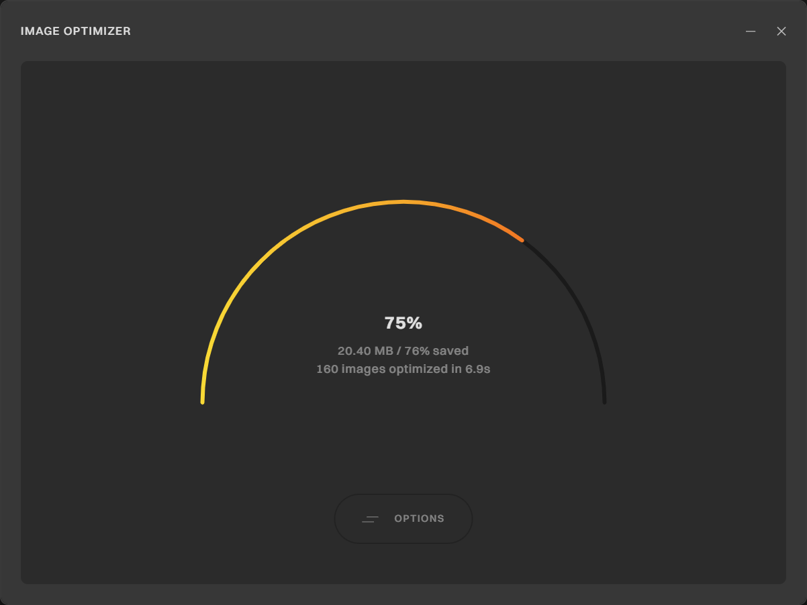

# Image Optimizer



Image Optimizer is a high-performance desktop application designed to streamline image compression and optimization without compromising visual quality. It offers advanced tools for rapid batch processing of images, including resizing, format conversion, and compression.

## Features

- **Visual Quality Preservation**: Optimizes file size while maintaining perceptual image quality
- **Format Conversion**: Convert between JPEG, PNG, WebP and AVIF while maintaining visual quality (SVG files are minified and keep their format)
- **Intelligent Resizing**: Multiple resize modes including width, height, longest and shortest side; the aspect ratio is always preserved and images are never enlarged
- **Quality Control**: One quality slider (1-100) that is translated into the right encoder settings for each format
- **Batch Processing**: Optimizes several images at once across your CPU cores
- **Non-destructive**: Originals are never touched; results are written to an `optimized` folder next to the source files
- **Color and Orientation Safe**: Photos taken in portrait are saved upright and wide-gamut colour profiles are converted to sRGB
- **Cross-Platform**: Available for Windows, macOS and Linux

## Use Cases

- **Web Developers**: Reduce page load times by up to 80% with optimized images for better SEO rankings and user experience
- **Content Creators**: Maintain visual quality while reducing file sizes by 30-80% for faster social media uploads
- **Photographers**: Process entire photoshoots in minutes instead of hours while preserving professional quality
- **E-commerce Managers**: Create consistent product images with uniform dimensions and optimal file sizes
- **UI/UX Designers**: Export perfectly sized assets for applications with predictable file sizes
- **Digital Marketers**: Reduce email campaign load times and improve engagement with optimized images
- **Storage Optimization**: Reduce storage requirements for large image collections without sacrificing quality

## Technology Stack

- **Tauri**: Modern framework for building smaller, faster, and more secure desktop applications
- **React**: Component-based UI with hooks for state management
- **SCSS**: Modular styling system with variables
- **Rust**: High-performance, memory-safe language for the core application logic
- **libvips**: High-performance image processing via vendored native Rust bindings
- **oxvg**: SVG minification (a Rust port of SVGO)

## Development Setup

You need Node.js 24, a recent stable Rust toolchain and the [Tauri prerequisites](https://tauri.app/start/prerequisites/) for your OS. The app also needs the libvips native library (the Rust bindings target libvips 8.15 or newer).

### libvips

- **Windows**: download `vips-dev-x64-web-8.18.7.zip` from the [libvips build-win64-mxe release](https://github.com/libvips/build-win64-mxe/releases/tag/v8.18.7) and extract it so that `vendor/libvips-native/` contains `bin/`, `lib/` and `include/`. Set `VIPS_DIR` to use another location. Debug builds copy the DLLs next to the executables automatically, so PATH needs no changes.
- **macOS**: `brew install vips pkg-config`
- **Linux**: install `libvips-dev` (8.15 or newer) and `pkg-config`, plus the Tauri system packages (`libwebkit2gtk-4.1-dev`, `libgtk-3-dev`, `libayatana-appindicator3-dev`, `librsvg2-dev`, `patchelf`)

### Run and check

```bash
npm install
npm run tauri:dev
```

```bash
npm run lint
```

`npm run lint` runs Biome (format and lint) and Clippy; `npm run lint:fix` also applies Biome's fixes. Run the Rust tests from `src-tauri/` with `cargo test`. Close the dev app first, because it keeps the build files locked on Windows.

## Documentation

- [Architecture](./ARCHITECTURE.md): components, the batch pipeline, native libraries and the release process
- [GitHub Actions](./GITHUB_ACTIONS.md): the CI/CD workflow
- [Changelog](./CHANGELOG.md)

## Security

- **Unsigned Builds**: Currently, both Windows and macOS builds are not code-signed. This is on the roadmap but doesn't affect the application's security.

- **Security Warnings**: You may encounter security warnings when first running the application:
  - **Windows**: You might see a "Windows protected your PC" message. Click "More info" and then "Run anyway" to proceed.
  - **macOS**: You may need to right-click (or Control-click) the app and select "Open" from the context menu, then click "Open" in the dialog that appears.

- **Local Processing**: Image Optimizer processes all images locally and never uploads them. The only network access is the update check, which contacts GitHub Releases on startup and can be turned off in the settings panel.

## Roadmap

- [x] Add SVG support
- [ ] Add expert settings toggle
- [x] Add additional performance optimizations
- [x] Add unsupported image format detection
- [x] Add macOS support
- [x] Add Linux support
- [x] Add updating mechanism
- [ ] Redesign the product website
- [ ] Design product logo & icons
- [ ] Implement code signing for Windows and macOS builds
- [x] Add multi-language support
